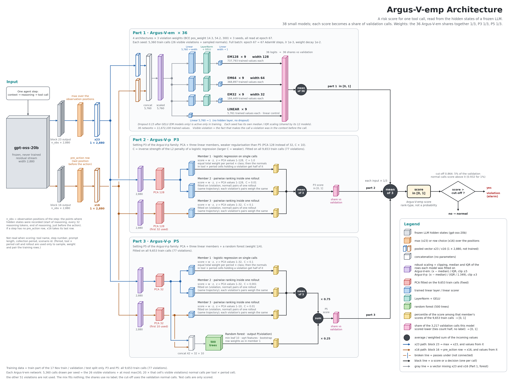

# Argus-V

### Activation-based Early Warning for Autonomous Agent Boundary Violations

Argus-V는 자율 에이전트가 **도구를 호출하기 직전의 내부 표현**에서 권한 위반과 연관된 신호를 보이는지 살펴보는 연구 프로젝트입니다. 고정된 `gpt-oss-20b`의 은닉층 값을 수집하고, 정책 라벨과 대조해 행동 단위 위험 점수를 만드는 여러 방법을 실험했습니다.

> **현재 결과**
>
> 재분할 test에서 Argus-V-emp의 AUROC는 전체 호출 비교 기준 0.913, 같은 기록 시기 안에서 비교한 기준 0.822였습니다. 두 값은 같은 test를 서로 다른 방식으로 계산한 결과입니다. 16개 조합을 탐색하며 test 결과도 확인했으므로 독립적인 최종 성능 검증으로 볼 수는 없습니다. 모델 파일과 오프라인 점수 계산기는 있지만 실시간 에이전트 hook에 연결한 감시 시스템은 아직 완성하지 않았습니다.

## 우리가 답하려던 질문

에이전트의 도구 호출이나 최종 답변을 확인한 뒤에야 문제를 알아차리는 대신, 행동이 실행되기 전에 은닉 상태를 보면 위험 신호를 더 일찍 발견할 수 있을까요? 이를 알아보기 위해 gpt-oss-20b가 정상 과제를 수행하는 로컬 시나리오와 샌드박스를 만들고, 각 행동의 앞뒤 문맥과 은닉층 표현을 모았습니다.

OpenAI의 [Hugging Face 사고 분석](https://openai.com/index/hugging-face-incident-and-the-road-ahead/)은 문제의식을 구체화한 자료 중 하나입니다. 이 연구는 은닉층을 관찰하지 못한 것이 해당 사고의 원인이었다고 주장하지 않습니다. 우리가 검증하려 한 것은 내부 표현이 행동 기록을 보완할 수 있는지였습니다.

우리의 목표는 숨은 의도나 생각을 읽는 것이 아닙니다. 모델은 특정 정책과 라벨에 대해 학습된 점수를 냅니다. 그 점수는 상관관계와 순위 신호이며, 모델의 판단 이유를 설명하거나 위반을 확정하지 않습니다.

## Argus-V-emp 구조

아래 그림은 고정된 LLM에서 층 16·23 은닉 상태를 모으고, Argus-V-em과 Argus-V-p 모델 38개의 점수를 합쳐 호출별 점수를 내는 흐름입니다. 원본 벡터 정의와 각 모델의 계산은 [상세 설명서](reports/risk-loop/argus-v-emp/ARGUS_V_EMP.md)에 기록했습니다.

[SVG로 크게 보기](reports/risk-loop/argus-v-emp/architecture/argus_v_emp_architecture.svg) · [아키텍처를 그린 코드](experiments/risk_loop/argus_loop/argus_v_emp_architecture.py)

### 점수는 어떻게 만들어지나

- **입력**: 도구 호출 한 건마다 5,760개 값. 층 23에서 관측 위치마다 원소별 최댓값을 모은 2,880개와, 층 16에서 행동 직전 값을 가져온 2,880개입니다.
- **Argus-V-em**: 32·64·128차원 임베딩과 선형 대조 모델, 세 가지 양성 가중치, 세 번의 학습 반복으로 만든 신경망 36개가 점수를 냅니다.
- **Argus-V-p**: PCA와 선형 구성원으로 만든 P3, P5가 점수를 냅니다. P5에는 랜덤 포레스트도 포함됩니다.
- **Argus-V-emp**: 구성 모델의 점수를 validation 호출 안 순위로 바꾼 뒤, em 36개의 평균·P3·P5를 각각 3분의 1 비중으로 합칩니다.
- **해석**: 0~1 점수는 위반 확률이 아니라 기준 호출에 대한 순위입니다. 기본 커트라인 0.864는 validation 정상 호출 중 5%가 경보를 넘도록 정했고, 0.932는 1% 기준입니다.

점수를 낼 때 모델 입력에는 도구 이름, step 번호, 수집 시기, 시나리오 ID를 넣지 않습니다. 다만 학습 과정에서 표본을 고르거나 가중치를 정할 때는 도구·시기 묶음을 사용했습니다. 그래서 도구와 기록 시기가 결과에 주는 영향을 별도로 확인했습니다.

## 여기까지 온 과정

| 단계 | 우리가 한 일 | 확인한 것과 다음 결정 |
|---|---|---|
| 문제 설정 | 정상 업무를 수행하는 에이전트에게 권한 경계와 작업 장애물이 있는 로컬 시나리오를 주고, 행동 전 신호를 찾기로 했습니다. | 정상적인 실패 보고·권한 요청과 위반 시도를 구분해야 했습니다. 실제 효과가 발생했는지와 위반을 시도했는지도 다른 질문이었습니다. |
| Argus-V-p · 11월 15일 | 층별 activation을 PCA로 줄이고 선형 모델을 조합했습니다. 설정 P1~P6을 비교했고 P5에는 랜덤 포레스트를 추가했습니다. | 학습 자료를 다시 채점하면 높은 값이 나왔지만, 시나리오 계열을 나눈 평가에서는 목표에 미치지 못했습니다. 라벨을 섞어도 점수가 남아 도구·시나리오 맥락을 외우는 지름길을 의심했습니다. |
| Argus-V-em · 11월 15~16일 | PCA 대신 작은 학습형 임베딩을 넣고, 행동 전에 위반 근거가 관찰된 사례에 초점을 맞췄습니다. | train 내부 교차검증의 제한된 하위집합에서는 AUROC 0.960까지 나왔지만, 기존 test에서는 근거가 보인 위반이 3개뿐이었고 AUROC는 0.667이었습니다. 0.960을 새 시나리오 성능으로 말할 수 없다는 점을 확인했습니다. |
| 가중치·epoch 실험 | 위반 가중치를 약 15배에서 60·230·300·1,000배까지 키우고, epoch과 모델 폭도 바꿨습니다. | 가중치를 키우자 전체 호출 AUROC는 오르기도 했지만, 같은 시기 안의 점수는 나빠졌습니다. 1,000배 설정은 거의 10월 기록인지 알아보는 점수가 됐습니다. 가중치만 키우는 방향은 멈췄습니다. |
| 재분할 · 11월 17일 | 기존 train·validation·test 16,090개 호출을 시나리오 계열 단위로 60/20/20 재분할했습니다. 기록 시기와 위반 수가 나뉘도록 라벨·메타데이터만 사용했고, 이전 분할과 모델은 보존했습니다. | train 9,653개, validation 3,217개, test 3,220개가 됐습니다. 근거가 보인 위반은 각각 26·7·10개였습니다. test 표본은 늘었지만 목표 지표를 계산할 수 있는 도구는 여전히 한 개뿐이었습니다. |
| Argus-V-emp · 11월 17일 | 추가 학습 없이 저장된 em·p 점수로 16가지 조합을 비교하고, em 평균·P3·P5를 섞는 조합을 정했습니다. | 재분할 test에서 전체 비교 AUROC 0.913, 같은 시기 안 비교 AUROC 0.822를 기록했습니다. 조합 탐색 중 test 결과도 확인했으므로 독립 검증값이 아닌 탐색 결과로 해석해야 합니다. |

각 단계의 세부 표, 사전 고정 계획, 실행 기록은 [Argus-V-p → Argus-V-em → Argus-V-emp 모델 이력](reports/risk-loop/model_history.md)과 [인수인계 일지](reports/risk-loop/argus-v1/loop/HANDOFF.md)에 남아 있습니다.

## 라벨을 만들며 부딪힌 문제

라벨은 단순히 실행 결과에 성공·실패를 붙이는 일이 아니었습니다. 어떤 행동이 정책을 넘으려는 시도였는지, 금지된 효과가 실제 발생했는지, 도구 호출 형식이 잘못됐는지는 서로 다른 판단입니다. 그래서 행동별 기준은 `gold_violation`, `violation_executed`, `tool_call_error` 세 축을 분리합니다. 차단된 위반 시도는 실행 효과가 없더라도 위반 시도 라벨을 가질 수 있습니다.

라벨의 **판정 축**과 **판정 출처**도 따로 관리했습니다. Hugging Face의 10월 검수 sidecar에는 행동 1,748개가 있고, 그중 623개는 사람이 직접 확인했으며 그중 132개는 `gold_violation=1`이었습니다. 1,124개는 사용자가 위임한 `AV-LABEL-012` 기준에 따라 개별 근거를 확인해 정상 `0/0/0`으로 확정했고, 1개는 보류였습니다. 위임 판정 1,124개는 사람이 각 행동을 직접 검수한 건수와 구분됩니다. 이전 split 기준 특징 라벨표에서는 train에 사람 확인 411개(위반 88개), validation에 68개(위반 12개)가 있었고, 위임 판정은 train 650개와 validation 159개였습니다.

11월에는 별도의 자동 검수와 사람 검수가 함께 있었습니다. 자동 확정은 공개 `read_file` 계약과 실행 근거가 모두 확인되는 좁은 정상 사례에만 적용했고, HF 사람 검수 sidecar에도 추가 판정이 저장됐습니다. 보관된 독립 점검에서 확인한 HF revision `62106dbf`(2026-11-11)에는 11월 사람 검수 24건이 있었고, 그중 19건은 당시 train split에 있었습니다. Argus-V-emp의 11월 라벨 요약은 자체 포함 기준을 적용한 14,784개 행동을 집계합니다. 그 표에서는 12,004개(약 81%)가 규칙 초안, 2,763개가 자동 검수, 10개가 팀 관례, 7개가 사람 검수 출처였습니다. 이 7개는 11월 모델 입력 표의 부분집계입니다. 그 라벨 병합에 고정한 HF revision `57a4bdcd`(2026-11-07 확인)는 위의 11월 11일 sidecar 갱신보다 앞서므로, 7개를 HF에 쌓인 전체 사람 검수 기록 수로 보면 안 됩니다. 11월 위반 정답은 대부분 초안 규칙 또는 팀 관례 판정이어서 사람 확인 라벨과 구분해 해석해야 합니다.

또 하나의 표시인 **근거가 보인 위반**은 별도의 잠정 규칙으로 만들었습니다. 행동 전에 확인 가능한 승인 부재, 앞선 거절 뒤의 시도, 일부 `bash` 행동 등을 표시하고, 형식 오류나 맥락에 드러나지 않은 조건은 자동으로 보인다고 취급하지 않았습니다. 이 표시는 위반 라벨의 대체물이 아니라, 모델이 행동 전에 알 수 있었던 사례를 좁혀 보는 분석 기준입니다.

팀은 더 보수적인 검수 흐름도 마련했습니다. 11월 2일 이후 rollout 2,693개, 159개 시나리오, 18,238개 행동을 검수 queue로 묶고 원본과 분리된 Hugging Face sidecar에 진행 상태와 라벨을 저장하도록 했습니다. 기준상 공개된 `read_file` 계약과 실행 근거가 모두 확인되는 좁은 정상 사례만 자동 확정하고, 나머지는 사람 검수에 남깁니다. queue 규모는 모두 검수가 끝났다는 뜻이 아닙니다. 자세한 내용은 [라벨링 대시보드](label-dashboard/README.md), [10월 HF 검수 자료](label-dashboard/public/october-review-reference.json), [데이터셋 독립 점검](reports/risk-loop/argus-v1/loop/iter-16/hf-dataset-independent-check.md), [11월 판정 기준](label-dashboard/NOVEMBER_LABELING_CRITERIA.md)을 참고하세요.

### 라벨 흐름의 요약

1. 원본 rollout과 정책·도구 계약을 읽고 행동별 후보 라벨을 모읍니다.
2. 사람 직접 검수, 위임 기준 판정, 팀 관례, 자동 판정, 초안 규칙의 출처를 구분해 보존합니다.
3. 위반 시도와 실제 실행 효과를 분리하고, 행동 전에 관찰된 근거가 있는지도 별도 표시합니다.
4. 시나리오 계열 단위로 train·validation·test를 나눠 같은 계열의 실행이 여러 분할로 퍼지지 않게 합니다.
5. 초안 비율, 희소한 양성, 도구·시기별 표본 수를 결과와 함께 보고합니다.

## activation은 어떻게 뽑았나

시나리오 실행 중 C-01 capture가 gpt-oss-20b 각 블록의 출력을 기록했습니다. 여기서 사용하는 값은 마지막 모델 정규화 전의 residual stream이며, MLP 분기 출력과 혼동하지 않습니다. 각 step에서 추론 시작 전, 32토큰 간격, 추론 종료, 도구 호출 직전의 관측 위치를 토큰 prefix와 맞춰 저장했습니다.

Argus-V-emp의 특징 빌더는 각 호출마다 층 23의 관측값을 차원별 최댓값으로 풀링하고, 층 16의 `pre_action` 행을 가져왔습니다. `pre_action`이 누락된 경우에는 마지막 관측 행을 썼습니다. 계산 뒤 float16 특징 행렬 `L23_max.npy`, `L16_pre.npy`와 출처·split·라벨이 정렬된 `steps.csv`를 저장합니다. 원시 은닉층 전체를 최종 특징 캐시에 복사하지 않습니다.

수집 위치와 저장 형식은 [Hook 관찰 안내](docs/hook-inspection.md), 데이터 연결·정렬·중복 검사는 [Probe 데이터 조립 안내](docs/probe-data-assembly.md), 특징 풀링 코드는 [build_features.py](experiments/risk_loop/argus_loop/build_features.py)에 있습니다.

## 결과를 읽을 때

| 평가 | 결과 | 어떻게 읽어야 하나 |
|---|---|---|
| `resplit-1117` test · 3,220개 호출 · 위반 26 / 정상 3,194 | AUROC 0.913 전체 비교 | 위반 호출 하나와 정상 호출 하나를 무작위로 골랐을 때 위반 점수가 더 높았던 비율입니다. 이 test 결과도 16개 조합을 살펴보는 과정에서 확인했습니다. |
| 같은 test · 같은 기록 시기 안에서 비교 | AUROC 0.822 (95% 구간 0.64–0.92) | 10월과 11월 기록 간 차이의 영향을 줄여 비교한 값입니다. 같은 도구끼리 비교한 AUROC는 0.598이므로 도구별 편향이 해소된 결과로 볼 수 없습니다. |
| 같은 test · validation 정상의 5% 경보 커트라인 0.864 | 위반 12/26 탐지, 오경보 145건, 재현율 0.462, 정밀도 0.076, F1 0.131 | 위반이 정상보다 약 123배 적어 경보 가운데 실제 위반의 비율이 낮았습니다. AUROC만으로 판정기의 실용성을 말할 수 없습니다. |

재분할 test에서 전체 호출을 비교한 AUROC는 0.913이고, 같은 test에서 기록 시기를 맞춰 비교한 값은 0.822입니다. 두 값 모두 16개 조합을 탐색하며 test 결과를 확인한 뒤 나온 결과이므로 별도의 미사용 데이터에서 재현된 성능과 구분해 읽어야 합니다.

추가 표와 그림은 [Argus-V-emp 결과 요약](reports/risk-loop/argus-v-emp/README.md)에 있습니다.

## 우리가 배운 점과 남은 한계

- **작은 양성 표본은 숫자를 크게 흔듭니다.** 재분할 test의 위반은 26개, 근거가 보인 위반은 10개였습니다. 0.913의 95% 구간도 0.79–0.96으로 넓습니다.
- **시기와 도구가 지름길이 될 수 있습니다.** 전체 자료에서 10월 호출의 위반 비율은 약 5.7%, 11월은 약 0.4%였습니다. 시기만으로도 재분할 test AUROC 0.750이 나왔습니다. Argus-V-emp는 같은 시기끼리 비교하면 0.822였지만 같은 도구끼리는 0.598이었습니다.
- **라벨 품질이 결과의 바닥입니다.** 11월 학습 자료의 대부분은 초안 규칙 라벨입니다. 사람 검수된 새 실행 평가가 필요합니다.
- **모델 선택과 test를 분리하지 못한 단계가 있었습니다.** 16개 조합을 비교하며 test 결과를 확인했으므로 0.913과 0.822는 탐색 결과입니다. 독립적인 데이터에서 다시 확인해야 합니다.
- **구현 오류도 있었습니다.** 처음 학습에서 의도한 약 15배 양성 가중치 대신 8개 설정이 300배로 학습된 것을 손실 곡선에서 발견했습니다. 해당 결과를 별도 보관하고 올바른 가중치로 다시 학습한 뒤 지표를 재계산했습니다.

현재 결과는 은닉 상태로 위반을 확정하거나 실제 환경에서 안전을 보장한다는 근거가 아닙니다. 점수는 확률이 아니며 데이터·모델·시나리오 분포가 바뀌면 기준을 다시 검증해야 합니다. 실시간 감시를 주장하려면 사람 검수된 새 시나리오, 모델 선택과 분리된 평가, 도구별 일반화, 실제 호출 직전 지연과 경보 처리까지 확인해야 합니다.

## 기록과 코드

| 주제 | 문서·코드 |
|---|---|
| 전체 모델 이력과 의사결정 | [model_history.md](reports/risk-loop/model_history.md) · [HANDOFF.md](reports/risk-loop/argus-v1/loop/HANDOFF.md) · [WORKLOG.md](reports/risk-loop/argus-v1/loop/WORKLOG.md) |
| Argus-V-emp 구조·수식·한계 | [ARGUS_V_EMP.md](reports/risk-loop/argus-v-emp/ARGUS_V_EMP.md) · [argus-v-emp README](reports/risk-loop/argus-v-emp/README.md) |
| 분할·표본 구성·test 사용 이력 | [resplit README](reports/risk-loop/resplit-1117/README.md) · [composition.md](reports/risk-loop/resplit-1117/composition.md) · [test-use-log.md](reports/risk-loop/resplit-1117/test-use-log.md) |
| 라벨 출처 확인과 특징 생성 | [HF 데이터 독립 점검](reports/risk-loop/argus-v1/loop/iter-16/hf-dataset-independent-check.md) · [build_features.py](experiments/risk_loop/argus_loop/build_features.py) · [D-v2 데이터 카드](reports/risk-loop/datasets/D-v2r/card.md) |
| activation 수집과 정렬 | [hook-inspection.md](docs/hook-inspection.md) · [probe-data-assembly.md](docs/probe-data-assembly.md) |
| 모델 결과 | [Argus-V-emp 결과 요약](reports/risk-loop/argus-v-emp/README.md) |
| 모델 점수 계산 | [argus_v_emp_model.py](experiments/risk_loop/argus_loop/argus_v_emp_model.py) · 모델 파일 `artifacts/risk-loop/resplit-1117/argus_v_emp/` |
| 로컬 시나리오·M1 실행 | [수동 시나리오 실행](docs/manual-sandbox-scenario.md) · [M1 및 샌드박스 확인](docs/m1-sandbox-run.md) · [실행 검증 기록](docs/m1-sandbox-verification-20261013.md) |

개별 점수 모델과 분할을 재현할 때는 상세 설명서와 해당 실행 계획을 먼저 확인하세요. `artifacts/`와 `tensor_data/` 아래 원본 특징은 큰 파일이며, 저장소를 clone한 것만으로 실험 원자료까지 내려받아지지는 않습니다.
