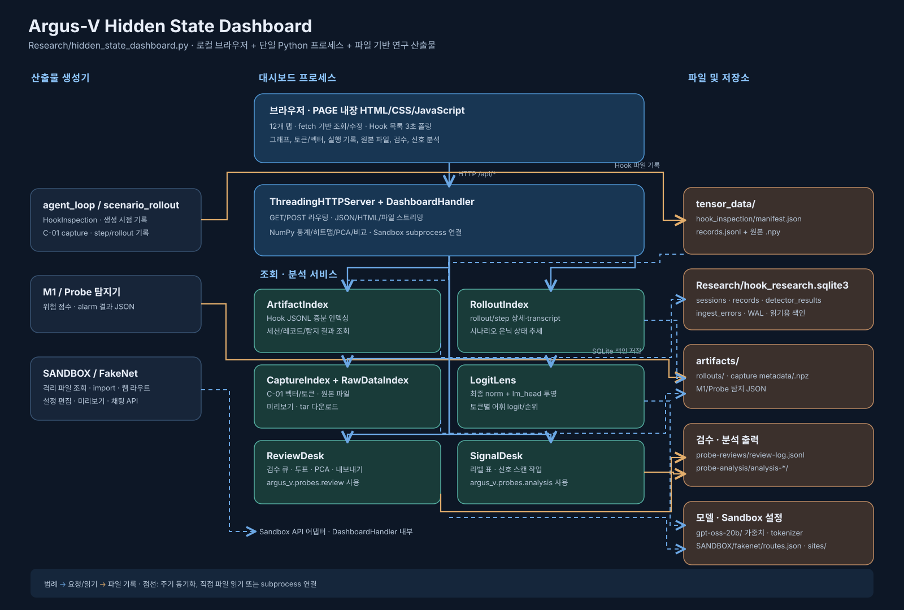

# Hidden State Dashboard 아키텍처

이 문서는 현재 [`Research/hidden_state_dashboard.py`](../Research/hidden_state_dashboard.py)를 기준으로, 대시보드의 실행 구조와 데이터 흐름을 설명한다. SVG는 주요 구성요소를 한눈에 보는 그림이고, 아래 설명은 코드의 실제 책임과 저장 경로를 풀어 쓴 것이다. 이 대시보드는 로컬 연구 도구로서 Python 표준 라이브러리 HTTP 서버와 한 파일에 내장된 브라우저 UI를 사용한다.

## 전체 흐름

1. `argus_hook/agent_loop.py`와 `argus_hook/scenario_rollout.py`의 실행 과정에서 `HookInspection`이 `tensor_data/` 아래 `manifest.json`, `records.jsonl`, 텐서 `.npy` 파일을 기록한다. 별도의 C-01 capture는 `metadata.json`과 `features.npz`를, 시나리오 실행기는 `artifacts/rollouts/<rollout>/` 아래 실행·step 기록을 남긴다. M1/Probe 탐지기는 `artifacts/`에 결과 JSON을 남긴다.
2. 대시보드 시작 시 `main()`이 설정 경로를 해석하고 `ArtifactIndex`, `RolloutIndex`, `CaptureIndex`, `RawDataIndex`, `ReviewDesk`, `SignalDesk`, `LogitLens`를 생성해 `DashboardHandler`에 연결한다. 기본 주소는 `127.0.0.1:8765`다.
3. 백그라운드 스레드가 약 1.5초 간격으로 Hook JSONL과 탐지 결과 JSON을 살펴 SQLite 메타데이터 색인을 갱신한다. 서버는 기존 산출물의 전체 색인 완료를 기다리지 않고 UI를 먼저 제공한다.
4. 브라우저는 서버가 제공하는 내장 `PAGE`의 JavaScript로 `/api/*`를 호출한다. Hook 목록은 3초마다 갱신한다. 요청한 텐서의 값·통계·시각화는 서버가 원본 `.npy`를 읽어 계산하며, 원본 파일 자체는 이 조회 과정에서 변경하지 않는다.
5. 검수 투표, 분석 결과 내보내기, Sandbox import 및 FakeNet 설정 편집은 명시적인 POST 요청으로 파일을 쓴다. 이 경로는 읽기 전용 조회 흐름과 구분해야 한다.

## 실행 프로세스와 UI

| 구성요소 | 코드 위치 | 역할 |
| --- | --- | --- |
| `main()` | `Research/hidden_state_dashboard.py` | CLI 옵션 해석, 서비스 객체 연결, 색인 스레드와 HTTP 서버 실행 |
| `ThreadingHTTPServer` / `DashboardHandler` | 같은 파일 | 요청별 스레드에서 HTML·JSON·다운로드 응답 처리; `do_GET`, `do_POST`가 라우팅 진입점 |
| `PAGE` | 같은 파일의 문자열 상수 | HTML/CSS/JavaScript 전체 UI. Hidden State 분석, 토큰별 은닉 상태, 시나리오 실행/은닉 상태, Capture, A/B 비교, Hook 위치, Sandbox 파일·웹, 원본 데이터, 라벨 검수, 은닉 신호 분석의 12개 탭 |
| `sync_loop()` | `main()` 내부 | `ArtifactIndex.sync_once()`와 `sync_detector_results()`를 주기적으로 호출 |

주요 CLI 옵션은 `--data-dir`(`tensor_data/`), `--db-path`(`Research/hook_research.sqlite3`), `--detector-dir`(`artifacts/`), `--rollouts-dir`(`artifacts/rollouts/`), `--review-dir`(`artifacts/probe-reviews/`), `--tokenizer`, `--model-dir`, `--host`, `--port`, `--replace`다. 기본 경로는 모두 저장소 루트를 기준으로 잡는다. `--replace`는 같은 포트를 점유한 이전 대시보드 프로세스를 찾아 종료한 뒤 다시 바인딩할 때 사용한다.

## 저장소와 서비스 객체

| 서비스 | 입력 / 저장소 | 하는 일 |
| --- | --- | --- |
| `ArtifactIndex` | `tensor_data/**/hook_inspection/records.jsonl` 및 generation 기록, `manifest.json`, `artifacts/**/*.json` → SQLite | 세션·레코드·탐지 결과의 검색용 메타데이터를 증분 저장. 실제 텐서 값은 SQLite에 복사하지 않는다. `sessions`, `records`, `detector_results`, `ingest_errors` 테이블을 사용한다. |
| `RolloutIndex` | `artifacts/rollouts/<id>/rollout.json`, `steps/step_*/step.json`, `transcript.md`, step의 capture | 시나리오 실행 목록과 상세, step 기록, 숨은 상태 추세를 읽는다. |
| `CaptureIndex` | `artifacts/**/capture/metadata.json`, `features.npz`, 인접 sidecar JSON | C-01 capture의 토큰·관찰 위치·레이어별 벡터를 읽는다. rollout 안의 capture는 일반 목록에서 제외하지만 ID로 직접 열 수 있다. |
| `RawDataIndex` | `tensor_data/`, `artifacts/rollouts/` | agent loop와 scenario rollout 원본 묶음을 탐색한다. 파일 목록·미리보기·단일 파일·비압축 tar 다운로드를 제공한다. 스캔 목록은 10초간 캐시한다. |
| `LogitLens` | `gpt-oss-20b/config.json`, safetensors 인덱스/가중치, `tokenizer.json` | 선택한 hidden vector를 최종 norm과 `lm_head`로 어휘 공간에 투영한다. BF16 가중치를 memory map으로 읽고 최근 계산을 캐시한다. 모델 파일이 없으면 이 기능의 요청에서 오류가 난다. |
| `ReviewDesk` | rollout·capture·분할표, `src/argus_v/probes/review.py` → `artifacts/probe-reviews/` | action/trajectory 검수 큐, 투표 로그, 분할 할당, 검수 JSON 내보내기, test 분할을 제외한 진단 PCA를 제공한다. |
| `SignalDesk` | `ReviewDesk`의 큐/검수 상태, `src/argus_v/probes/analysis.py` → `artifacts/probe-analysis/` | 라벨 표의 충분성·교란 요인·중복 검사, 별도 스레드의 레이어×시점 신호 스캔, CSV/JSON 내보내기를 담당한다. |
| Sandbox 연결 | `SANDBOX/sandbox.py`, `SANDBOX/fakenet/server.py`, `SANDBOX/fakenet/routes.json`, `sites/` | 컨테이너 파일 조회·이미지 읽기·아카이브 import는 subprocess로, FakeNet 라우트와 사이트 파일은 로컬 파일 및 공용 handler로 처리한다. |

`ArtifactIndex`는 완전한 줄바꿈으로 끝난 JSONL 행까지만 반영하고 마지막 읽기 바이트 위치를 `sessions.records_offset`에 보관한다. 다음 순회에서 이어 읽으며 파일이 짧아졌으면 해당 세션 레코드를 다시 만든다. Hook 레코드 색인은 현재 레이어 **0, 11, 23**만 담는다. 탐지 결과는 `snapshot.run_id`, `configuration.monitor`, `alarm`을 가진 JSON만 받아 색인하고, 같은 `run_id`의 Hook 레코드에 위험 정보를 연결한다. SQLite는 WAL 모드를 사용한다.

## HTTP API와 데이터 경로

| API 묶음 | 제공 내용 | 주 사용 객체 |
| --- | --- | --- |
| `/`, `/hooks`, `/tokens`, `/captures`, `/rollouts`, `/scenario-hidden`, `/rawdata`, `/review`, `/signal` | 같은 `PAGE` 반환, 브라우저에서 해당 탭 선택 | `DashboardHandler` |
| `/api/records`, `/api/hooks/*`, `/api/tokens/*` | Hook 검색, 모듈 트리, 생성 토큰별 기록·벡터·어휘 투영 | `ArtifactIndex`, `LogitLens` |
| `/api/tensor`, `/api/plot`, `/api/prompt`, `/api/heatmap`, `/api/embedding`, `/api/compare` | 원본 `.npy` 페이지 조회, 분포·히트맵·PCA/t-SNE·A/B 수치 비교 | `ArtifactIndex` 조회 후 `DashboardHandler`의 NumPy 계산 |
| `/api/rollouts/*`, `/api/captures/*` | 실행/step 기록, capture 벡터와 토큰, 시나리오 은닉 상태 추세 | `RolloutIndex`, `CaptureIndex`, `LogitLens` |
| `/api/rawdata/*` | 원본 파일 목록, 미리보기, 파일 및 tar 스트리밍 다운로드 | `RawDataIndex` |
| `/api/review/*` | 큐·항목·투영 GET, 투표·분할 할당·내보내기 POST | `ReviewDesk` |
| `/api/signal/*` | 개요·작업 상태 GET, 스캔 시작·내보내기 POST | `SignalDesk` |
| `/api/sandbox/*`, `/simsimi/api/*` | Sandbox 파일/import/이미지, FakeNet 설정·미리보기, 채팅 API | `DashboardHandler`, Sandbox subprocess, FakeNet handler |

Hook 분석의 요청 순서는 `브라우저 → /api/records → SQLite의 레코드 키 → /api/tensor 등의 요청 → 원본 .npy 읽기 → JSON 시각화 데이터`다. `np.load(..., mmap_mode="r", allow_pickle=False)`를 사용하는 주요 Hook 텐서 경로에서는 전체 배열을 먼저 복사하지 않고 필요한 구간이나 집계를 계산한다. 값 목록은 페이지 단위로 보내며, 히트맵은 표시용 샘플을 만들어 응답한다. 원본 텐서가 손상되거나 아직 기록 중이면 오류를 반환할 수 있다.

검수 경로는 `rollout/capture → ReviewDesk의 큐 → review-log.jsonl → reviews-*.json`이다. `SignalDesk`는 이 큐와 검수 상태를 재사용한다. `/api/signal/scan`은 응답을 기다리는 동안 계산을 붙잡아 두지 않고 별도 daemon 스레드에서 실행하며 `/api/signal/job`으로 상태를 폴링한다. 분석 내보내기는 `analysis.csv`, `columns.json`, `report.json`을 기록한다.

## 경계와 운영상 특성

- 대시보드의 기본 바인딩은 `127.0.0.1`이다. 서버는 `ThreadingHTTPServer`이므로 브라우저 요청과 색인 스레드가 동시에 동작한다.
- 텐서·capture·원본 파일 경로는 지정된 루트 아래인지 검사한다. `np.load`에는 `allow_pickle=False`를 사용한다. 원본 데이터 다운로드는 선택 파일을 스트리밍한다.
- `ReviewDesk`와 `SignalDesk`는 `src/argus_v/probes/` 모듈을 첫 사용 시 가져온다. PCA는 NumPy로 계산하고 t-SNE는 선택 의존성인 scikit-learn이 필요하다.
- 이 도식의 생성기는 대시보드가 직접 실행하는 종속 서비스가 아니다. 파일을 먼저 생산하고, 대시보드는 그 결과를 읽는다. 모델 가중치와 Sandbox도 해당 기능을 호출할 때만 필요하다.

## 확인한 코드

- [`Research/hidden_state_dashboard.py`](../Research/hidden_state_dashboard.py): UI, 인덱스, 서비스, HTTP 라우팅, 시작 함수
- [`src/argus_v/activations/inspection.py`](../src/argus_v/activations/inspection.py): Hook 산출물 기록
- [`src/argus_v/activations/storage.py`](../src/argus_v/activations/storage.py): C-01 capture 저장
- [`argus_hook/scenario_rollout.py`](../argus_hook/scenario_rollout.py): 시나리오 실행 및 capture/Hook 기록
- [`src/argus_v/probes/review.py`](../src/argus_v/probes/review.py), [`src/argus_v/probes/analysis.py`](../src/argus_v/probes/analysis.py): 검수와 신호 분석 로직
